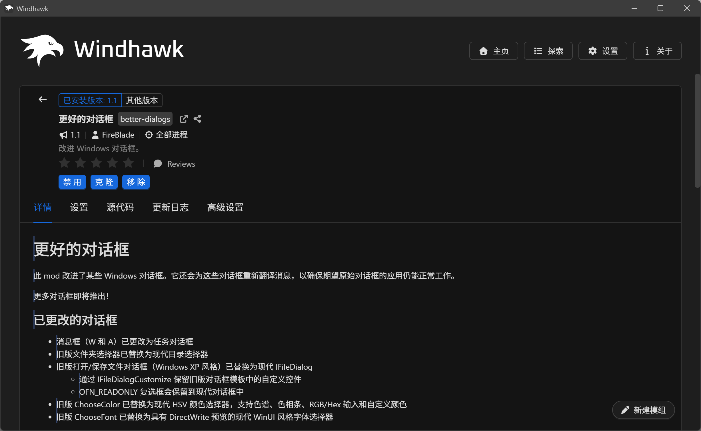
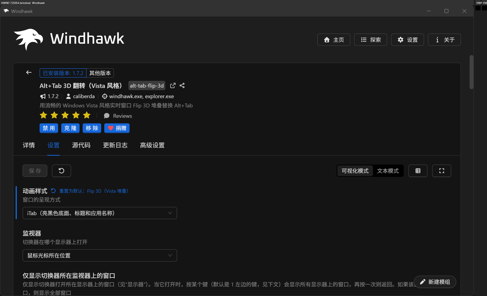
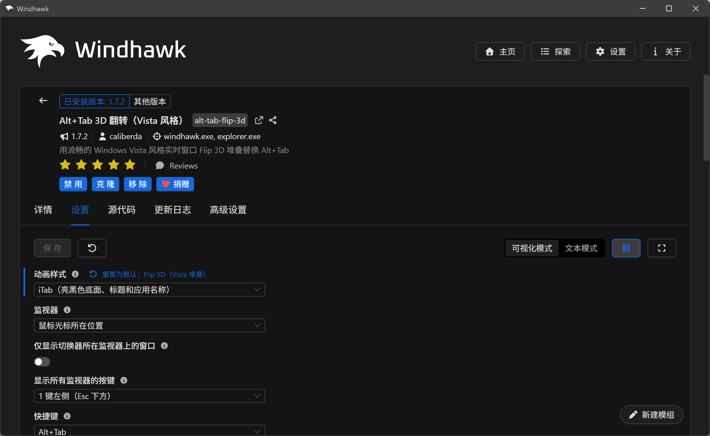
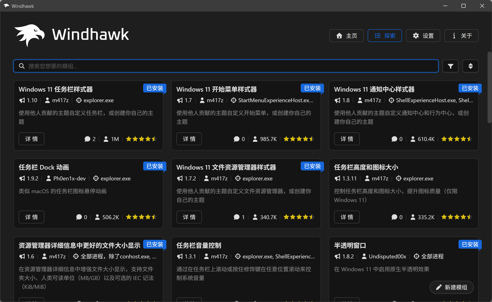

# Windhawk UI Translator

A Windhawk mod that translates the content other mods write — mod names,
one-line summaries, READMEs, changelogs, and everything on a mod's settings
page — in place, inside the Windhawk 2.0 window.

Windhawk 2.0 localizes its own interface, but not what mod authors write.
Names and summaries only have the narrow `@name:zh-CN` /
`$description:zh-CN` / `$options:zh-CN` metadata channel, and READMEs and
changelogs have none. Existing community tools patch Windhawk 1.x
(VSCodium/Electron) files on disk and cannot reach the Tauri-based 2.0 UI
(`windhawk-ui.exe`, WebView2), so this mod works from inside the UI process.



## What gets translated

| Where | What | Scope switch |
| --- | --- | --- |
| Details page | README, changelog | `scopeReadme`, `scopeChangelog` |
| Details page, explore grid, installed table | mod name and one-line summary | `scopeModName`, `scopeModSummary` |
| Settings page | titles, descriptions, tooltips, dropdown values and options, reset labels | `scopeSettings` |
| Update dialog | mod names, and the changelog of each offered update | `scopeModName`, `scopeChangelog` |







Two things are not translated: the Source tab (a CodeMirror virtualized view)
and Windhawk's own interface strings, which Windhawk already localizes.

## Behaviour

* The translation replaces the original text in place; nothing is added to
  the layout.
* Hover a translated block to see the original; move away to restore it. On a
  touch screen, tap once for the original and again for the translation.
* `Alt+Q` toggles translation, as does a two-finger double-tap on touch
  screens. Both are configurable.
* Translations are cached by the mod (not in the page's storage) for 30 days,
  capped at 8 MB, oldest evicted first. The cache key includes the provider
  and model, so switching providers does not serve stale text.
* The default target language follows Windhawk's UI language (the mod reads its
  registry setting), then the page's `lang`, then the Windows display language.
  The 2.0 alpha's page `lang` is static English, so the second step rarely
  helps; a portable build has no reliable registry value and may not follow its
  own instance's language. A language change takes effect on the next page load
  or settings change.

## Providers and the API key

* **OpenAI-compatible LLM** — any `/chat/completions` endpoint. Batched JSON
  requests with a glossary and placeholder preservation. Recommended.
* **Microsoft Edge** — the free endpoint; no key needed, and the fallback when
  the LLM is unavailable.
* **Google** — not offered and **not implemented**; a stale `provider: google`
  config falls back to Edge.
* `auto` prefers the LLM only when a key is configured; one failed retry moves
  the session to Edge.

The page's CSP blocks translation APIs, so the page sends every request through
the mod over a plain-text web-message protocol and the mod does the HTTP itself
(WinHTTP). This also keeps the key safe: the mod reads it from Windows
Credential Manager (a plaintext setting is the fallback) and injects
`Authorization` only for the configured `llmBaseUrl` host, only over HTTPS,
never for the free endpoint. The key never reaches the page and is never
logged.

```powershell
# store the key in Windows Credential Manager
cmdkey /generic:windhawk-ui-translator /user:translator /pass:<your key>
```

## Install

Requires Windhawk 2.0.0-alpha.8 (the Tauri UI). Enable the mod while the UI is
closed, or restart `windhawk-ui.exe` afterwards — in a running process the
WebView2 environment already exists, and the mod can only hook its creation.
Restarting only the tray icon is not enough.

```powershell
# compile and install from the repository source
& "C:\Program Files\Windhawk\windhawk-cli.exe" mod install --file "mods\windhawk-ui-translator.wh.cpp"
```

If the UI fails to start:

```powershell
windhawk.exe -safe-mode
# or
& "C:\Program Files\Windhawk\windhawk-cli.exe" mod disable windhawk-ui-translator
```

## Development

```powershell
bun tools/build.ts          # inline src/js/engine.js into the mod source
bun tools/test.mjs          # jsdom suites (all checks must pass)
scripts\dev.ps1 install     # compile + install (admin, no restart)
scripts\dev.ps1 restart     # restart windhawk-ui.exe
scripts\dev.ps1 log -Seconds 60
```

`docs/PLAN.md` records the verified WebView2 facts and the injection chain,
`docs/PROTOCOL.md` the page↔mod message protocol, `docs/FINDINGS-p0.md` the
runtime observations, `docs/PUBLISHING.md` the release checklist.

## Privacy

Translated text goes to the provider you configure. No telemetry, no other
network access. The API key is read from Windows Credential Manager; the
optional plaintext setting is the fallback, stored in Windhawk's own settings.

## License

GPL-3.0. The in-page engine derives in part from
[kiss-translator](https://github.com/fishjar/kiss-translator) (GPL-3.0); see
[NOTICE](NOTICE).
