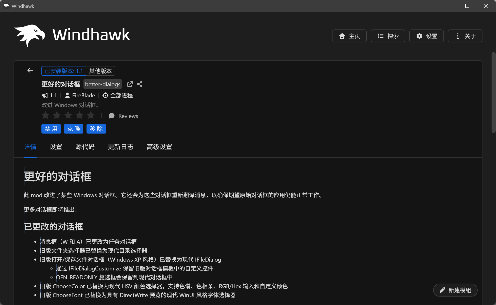
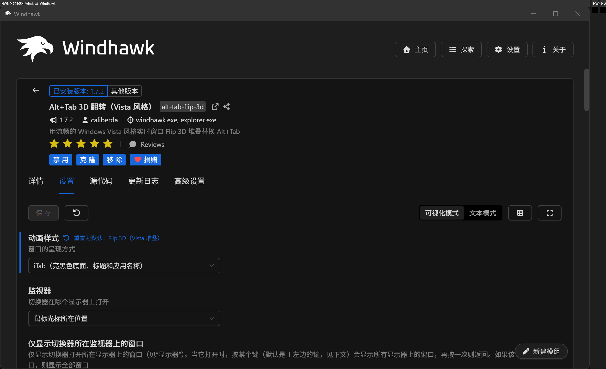
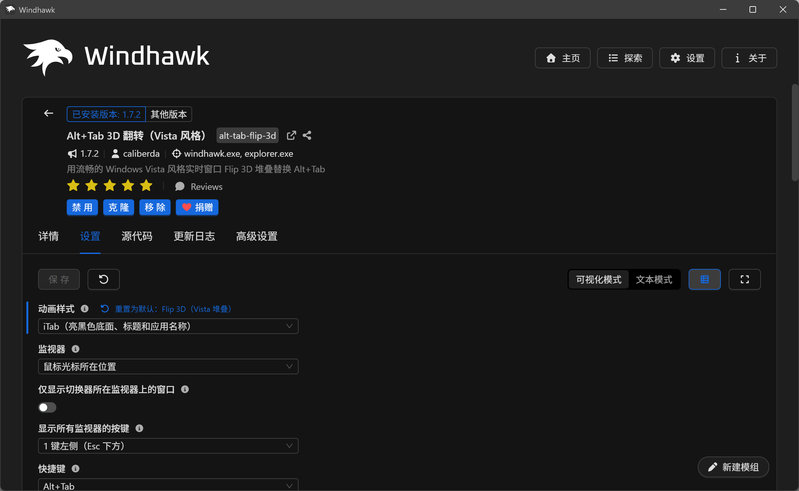
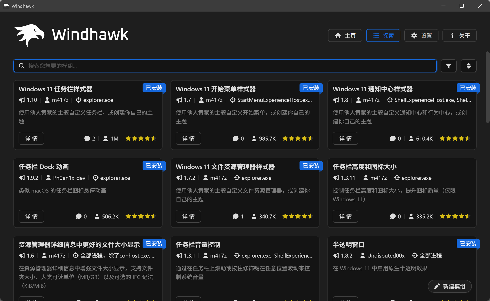

# Windhawk 界面翻译

一个 Windhawk 模组：在 Windhawk 2.0 窗口里就地翻译**其他模组写的内容**——模组名称、
一句话简介、说明文档（README）、更新日志，以及模组设置页里的全部文字。

Windhawk 2.0 自身的界面已经本地化，但模组作者写的内容不在其中。名称和简介只有
`@name:zh-CN` / `$description:zh-CN` / `$options:zh-CN` 这一条很窄的元数据通道，
README 和更新日志则完全没有本地化机制。本模组补上的就是这一块。现有的社区工具都是
改 Windhawk 1.x（VSCodium/Electron 版）磁盘上的 webview 文件，够不到 Tauri 版 2.0
界面（`windhawk-ui.exe` + WebView2），所以本模组改为在界面进程内部工作。



## 翻译范围

| 位置 | 内容 | 开关 |
| --- | --- | --- |
| 详情页 | 说明文档、更新日志 | `scopeReadme`、`scopeChangelog` |
| 详情页、探索磁贴、已安装列表 | 模组名称与一句话简介 | `scopeModName`、`scopeModSummary` |
| 设置页 | 标题、说明、提示气泡、下拉值/选项、重置标签 | `scopeSettings` |
| 更新弹窗 | 模组名称，以及每个待更新模组的更新日志 | `scopeModName`、`scopeChangelog` |

设置页是文字最密集的地方，两种密度下都已适配：







有两处刻意不翻：源码页（CodeMirror 虚拟化视图），以及 Windhawk 自身的界面文字
（已由 Windhawk 本地化）。

## 交互方式

* 译文就地替换原文，不往版面上加任何东西。
* 鼠标停在已翻译的段落上显示原文，移开恢复译文；触屏上点一下显示原文，再点恢复译文。
* `Alt+Q` 开、关翻译，触屏上双指连点两次效果相同。两者都可配置，且开关始终双向可用。
* 译文由模组缓存（不使用页面存储），有效期 30 天，上限 8 MB，超出时优先淘汰最旧的
  条目。缓存键包含翻译服务与模型，换了服务不会读到旧译文。
* 默认目标语言跟随 Windhawk 界面语言，其次跟随 Windows 显示语言。

## 翻译服务与密钥

* **兼容 OpenAI 的大模型**——任意 `/chat/completions` 接口。批量 JSON 请求，支持
  术语表与占位符保护，推荐使用。
* **微软 Edge**——免费接口，无需密钥，也是大模型不可用时的兜底。
* **Google**——设置中已不再提供，也**未实现**；旧配置里若仍是 `provider: google`，
  会回落到 Edge。
* `auto` 只在配置了密钥时优先用大模型；大模型请求重试一次仍失败后，本次会话余下
  时间回落到 Edge。

页面 CSP 不允许连翻译接口，所以页面把每个请求通过纯文本 web message 协议交给模组，
由模组用 WinHTTP 发出。这同时也是密钥的保护机制：模组从 Windows 凭据管理器读取
密钥（明文设置项作为备用），只对 `llmBaseUrl` 主机的请求、只在 HTTPS 下注入
`Authorization`，免费接口永远不带密钥。密钥不会进入页面，也不会写进日志。

```powershell
# 把密钥写入 Windows 凭据管理器
cmdkey /generic:windhawk-ui-translator /user:translator /pass:<你的密钥>
```

## 安装

需要 Windhawk 2.0.0-alpha.8（Tauri 界面）。请在界面关闭时启用模组，或启用后重启
界面进程（`windhawk-ui.exe`）——运行中的界面进程里 WebView2 环境已经创建好了，模组
只能挂钩它的创建。只重启托盘图标不算。

```powershell
# 从仓库源码编译安装
& "C:\Program Files\Windhawk\windhawk-cli.exe" mod install --file "mods\windhawk-ui-translator.wh.cpp"
```

启用后界面若起不来：

```powershell
windhawk.exe -safe-mode
# 或
& "C:\Program Files\Windhawk\windhawk-cli.exe" mod disable windhawk-ui-translator
```

## 开发

```powershell
bun tools/build.ts          # 把 src/js/engine.js 内联进模组源码
bun tools/test.mjs          # jsdom 测试（须全部通过）
scripts\dev.ps1 install     # 编译并安装（需管理员，不重启）
scripts\dev.ps1 restart     # 重启 windhawk-ui.exe
scripts\dev.ps1 log -Seconds 60
```

`docs/PLAN.md` 记录设计所依赖的、已实测的 WebView2 事实与注入链路，
`docs/PROTOCOL.md` 是页面↔模组消息协议，`docs/FINDINGS-p0.md` 是运行时观察，
`docs/PUBLISHING.md` 是发布清单。

## 隐私

译文文本会发送给你配置的翻译服务。没有遥测、没有统计，除该服务外不访问网络。
密钥从 Windows 凭据管理器读取；可选的明文设置是兜底路径，保存在 Windhawk 自己的设置里。

## 许可证

GPL-3.0。页内引擎部分派生自 [kiss-translator](https://github.com/fishjar/kiss-translator)
（GPL-3.0），见 [NOTICE](NOTICE)。
